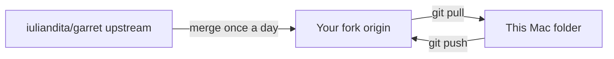

# Quick start

This is how to navigate garret on Timothy’s Mac Studio. The writing, the program, and the source code are three different folders. Open this file when you need the paths again.

garret is an offline writing studio. The manuscript, outline, and library live on this Mac. There is no account, and the book is not a website. The public site [usegarret.com](https://usegarret.com) is only the project’s web page. This checkout is version 0.0.10 alpha. Keep a backup. The product description is in `README.md`.

## The three folders

| What you open | Where it is | What it holds |
| --- | --- | --- |
| The Dock icon | `/Users/timothy/Applications/garret.app` | The program you write in. Clicking it opens the library. |
| A book, after you create one | `/Users/timothy/Documents/Books/` | The writing. One book is one `.db` file, plus any sibling folders. |
| This folder in Cursor | `/Users/timothy/Garret-Book-Builder` | The source code the program was built from. It does not contain the story. |

The window title **Library - garret** means the library screen of the app named garret. Library is not a separate program, and it is not named Library Garrett.

`garret` is spelled with one t, in the Dock, in the folder names, and in the window title.

Cursor and the Dock app are not connected while you write. Editing this folder does not change the Dock app. Writing in the app does not change this folder. How this folder receives updates is in [How the copies stay in sync](#how-the-copies-stay-in-sync).

## Where a book stays

Choose **+ New book** in the library. garret saves that book in `/Users/timothy/Documents/Books/`.

The file ends in `.db`. That file holds the outline and the prose. It stays in that folder until you delete the book inside the app. You do not need to export it to keep it. Exporting to Markdown or Word makes a second copy on purpose. Skip the export when you only want the one working book.

Two small files may sit beside the `.db`: `.db-wal` and `.db-shm`. They are part of the same database. If pictures or research were added, `.pictures` and `.research` folders sit beside it too. A backup of the book is the `.db` together with those siblings. Copy them only while garret is closed.

The library list, and the name **Timothy J. Smith**, live in `/Users/timothy/.local/share/garret/`. That folder is not the manuscript. Automatic recovery copies are under `recovery/` inside it. Startup errors are written there as well. This Mac does not use `~/Library/Application Support` for garret. An absolute `XDG_DATA_HOME` overrides that data folder. A relative value is ignored.

A backup of your home folder includes both `Documents/Books` and `.local/share/garret`. Time Machine does that for this Mac. A NAS copy includes them when the backup job copies the home folder.

## Open the library and the book

These are two screens in one app.

1. Click **garret** in the Dock. If the icon is missing, open `/Users/timothy/Applications/garret.app`.
2. The library is the first screen. **All** shows every book. **New pen name…** adds another byline. Leave it unused when one name is enough. The name on this Mac is Timothy J. Smith.
3. Click the book name, or **Continue writing**, to open the writing screen. The outline is on the left. The prose is on the right.
4. Click the house icon (its label is **Home: Library**), or choose **File > Library…**, to return to the library.

If the writing screen says **No book is open**, you are between those two views. Click **Open the library**, then click the book.

A new book asks for a project type: Novel, Short fiction, Nonfiction, or Story collection. On a new short story, garret creates one scene and names it **Scene 1**. The story has to sit in a scene, so that row is there from the start. Right-click the name in the left outline and choose **Rename…**. The heading on the page follows that name. The heading is not a line in the story, so Backspace will not remove it.

**Part 1** is not added for you. That row appears only after it is created from the outline. Right-click it and choose **Delete** to send it to Trash. Trash keeps the row on screen until Trash is emptied.

Do not delete the only scene if you want to keep the story. Delete moves that scene, prose included, to Trash.

When a book is open, **File > Export manuscript (Markdown)** and **File > Export for an editor (Word)** write a copy for another program.

Spelling is turned on in the settings on this Mac. garret does not include an AI writer, and it does not send the book off this Mac.

The earlier short story was removed from the library so the shelf could start empty. The separate text file is still at `/Users/timothy/Documents/The One-Armed Boxer with Sandpaper Shoes.md`. That file is not a garret book. Pasting it into a new book is what puts it in the library.

## The public site is not the app

`site/` in this folder is a short redirect page. It is not the editor. On this Mac, port 8080 already belongs to Open WebUI. Opening `http://127.0.0.1:8080` shows that other program, including a “detail / Not Found” page. Leave 8080 alone.

To view the redirect page, from this folder:

```sh
bash scripts/build-site
python3 -m http.server 8765 --bind 127.0.0.1 --directory app/dist-site
```

Open [http://127.0.0.1:8765/](http://127.0.0.1:8765/). Use that address. The server listens on IPv4 only, so `localhost` can miss it. The page is titled “garret has a new home,” then it leaves for [https://usegarret.com/](https://usegarret.com/). Press Ctrl+C in the terminal when you are done. If 8765 is taken, pick another free port and use that number in both the command and the address.

Opening `app/ui/index.html` in a browser does not start the studio. The writing window needs the Mac program.

## Install on this Mac Studio

These steps are the ones that worked. The tools are already installed on this Studio. Use this list on a new login, or when a terminal says a command cannot be found.

1. Install Apple’s command-line tools, Rust, and Bun if a new Mac does not have them. Python 3 and Git are already on this Studio.

```sh
xcode-select --install
curl --proto '=https' --tlsv1.2 https://sh.rustup.rs -sSf | sh
source "$HOME/.cargo/env"
curl -fsSL https://bun.sh/install | bash
```

2. Open a new terminal window, then load the tools into it. This Studio already has Bun 1.4.4 and Rust. A terminal opened before Bun was installed will still say `command not found` until you load the shell again.

```sh
source "$HOME/.zshrc"
source "$HOME/.cargo/env"
bun --version
cargo --version
```

`bun --version` should print `1.4` or newer. `cargo --version` should print as well. If either command is still missing, quit the terminal, open a new one, and run the two `source` lines again.

3. Install the project dependencies from this folder.

```sh
cd /Users/timothy/Garret-Book-Builder
bun install
```

4. Build the interface and the program, then launch the source-tree window.

```sh
cd /Users/timothy/Garret-Book-Builder
scripts/run-app
```

The first Rust build takes several minutes. Later launches still rebuild the interface, then reuse the Rust program if `app/shell-tauri/src-tauri/target/release/garret` is already there. The script copies the built interface into `app/shell-tauri/dist` before compiling. That copy is required. Without it, the build stops on `resource path '../dist' doesn't exist`.

`scripts/run-app` opens a window from the binary inside this folder. It does not replace the Dock app.

5. The Dock app is the separate copy at `/Users/timothy/Applications/garret.app`. **Options > Keep in Dock** on that icon keeps this build. The downloaded copy that macOS refused to open lived in `/Applications` and has been deleted. Do not install another download there.

## Open it again

To write, click **garret** in the Dock. That is the whole daily step. The window is the app. It is not a browser tab and not an HTML file.

Use the terminal only when you are rebuilding from this folder:

```sh
source "$HOME/.zshrc"
source "$HOME/.cargo/env"
cd /Users/timothy/Garret-Book-Builder
scripts/run-app
```

After a change to the Rust source, `scripts/run-app` will not recompile once that binary exists. Build it yourself, then launch:

```sh
cd /Users/timothy/Garret-Book-Builder/app/shell-tauri/src-tauri
cargo build --release
cd /Users/timothy/Garret-Book-Builder
scripts/run-app
```

That new window is still the source-tree program. The Dock icon keeps the copy inside `garret.app` until that bundle is replaced. Quit garret first, then copy the new program and interface into the bundle:

```sh
cp /Users/timothy/Garret-Book-Builder/app/shell-tauri/src-tauri/target/release/garret \
  /Users/timothy/Applications/garret.app/Contents/MacOS/garret
rm -rf /Users/timothy/Applications/garret.app/Contents/MacOS/dist
cp -R /Users/timothy/Garret-Book-Builder/app/ui/dist \
  /Users/timothy/Applications/garret.app/Contents/MacOS/dist
```

Run one copy at a time. The Dock app and a `scripts/run-app` window are two launches of garret.

`scripts/package-macos` is a different build. It wants a clean git checkout and writes a `.app` and a disk image under `app/dist-macos/`. That is not the Dock icon, and it is not required for writing.

## If a command fails

`bun` or `cargo` is not found. Run the two `source` lines above, or open a new terminal.

The build says `resource path '../dist' doesn't exist`. Start through `scripts/run-app`, which creates `app/shell-tauri/dist` from the built interface.

The window is blank and says the interface was not found. Build with `scripts/run-app`. If `APP_DIST` is set to a folder that has no `index.html`, the app uses only that path. For a normal launch, run `unset APP_DIST`.

Rust edits seem ignored. The launcher skipped `cargo build` because the binary was already there. Use the `cargo build --release` commands above.

The browser shows “detail / Not Found” or “Pretty-print detail not found.” That answer came from Open WebUI on port 8080. Serve the redirect page on 8765, as above.

A start failure is printed in the terminal and written under `/Users/timothy/.local/share/garret/`.

Do not set `GDK_BACKEND`. The launcher exports it for a Linux keyboard issue. You do not set it on this Mac.

Do not copy a Linux `privacy.json` into `/Users/timothy/.local/share/garret/`. If that file is locked or in recovery, this Mac build refuses to start.

## Limits of this Mac build

`scripts/macos/README.txt` marks PDF proof, preview, and the PIN privacy lock as Linux-only in this preview. The PIN hides the app when you step away. It does not encrypt the manuscript. Spelling, the dictionary, accessibility, window behavior, and the single-instance guard have not been certified on a Mac. A binary you built and launched from Terminal is usually allowed. A downloaded `.app` is ad-hoc signed and not notarized, which is why macOS blocked the copy that used to be in `/Applications`.

## A MacBook Air is a different disk

The same paths can appear on a MacBook Air, including `/Users/timothy/Documents/Books`, and they still belong to that other computer. Writing saved on the Studio does not appear on the Air. The Dock app on the Studio does not appear on the Air.

To write on the Air:

1. Repeat the install steps above on the Air, in a copy of this source folder.
2. Build `garret.app` there, or copy `/Users/timothy/Applications/garret.app` from the Studio onto the Air.
3. Copy a book into the Air’s `Documents/Books` folder only when that Air should have the same book. Copy the `.db` and its sibling files and folders, with garret closed.

Copying the source folder copies the program’s recipe. It does not copy the books.

## How the copies stay in sync

Three copies of the program source are involved. Your books are a fourth place, and they stay outside this.

1. **Fork.** [timothy-j-smith/Garret-Book-Builder](https://github.com/timothy-j-smith/Garret-Book-Builder) is your copy on GitHub. It began as a copy of [iuliandita/garret](https://github.com/iuliandita/garret). Commits you make, including `QUICK-START.md` and the Mac change in `scripts/run-app`, live on this fork.
2. **Clone.** This folder, `/Users/timothy/Garret-Book-Builder`, is the clone. It is the copy on the Mac that Cursor edits.
3. **Origin.** Origin is the name Git uses for your fork. `git push` sends commits from this folder to origin. `git pull` brings origin’s new commits into this folder.
4. **Upstream.** Upstream is the name Git uses for `iuliandita/garret`, the original project. This Mac can read it. The push address for that remote is disabled, so a push from this folder goes to your fork.
5. **Merge.** A merge combines the two histories into one. A file that exists only on your fork, such as `QUICK-START.md`, stays. A file that only the original project changed is brought in. When both sides have changed the same lines, the merge stops and the fork is left as it was.
6. **The daily sync.** GitHub runs `.github/workflows/sync-upstream.yml` on your fork once a day, at 13:15 UTC. That job fetches upstream and merges `develop` into your fork. You can also start it by hand: open the Actions tab, choose **Sync upstream**, and run the workflow. A stopped merge shows up as a failed run. Your files remain on the fork.
7. **Pull.** After the fork has those new commits, this folder still has the older copy until you run `git pull`. Uncommitted edits in the folder stay when they do not overlap the incoming commits. `Documents/Books` and the Dock app are outside Git, so this sync leaves your stories and `garret.app` where they are.
8. **Push.** `git push` publishes commits from this folder to your fork. The original project stays as its author left it.



To bring upstream in before the daily run, from this folder:

```sh
git fetch upstream
git merge upstream/develop
git push origin develop
```

`git pull` is the step that updates this folder after the fork already has the new commits. If either command stops on an overlap, leave the files as they are and sort out the shared lines before you continue. `QUICK-START.md` is only on your fork, so a normal merge keeps it.

## What to hand to another agent

Share `/Users/timothy/Garret-Book-Builder` when the question is about the program. Share the `.db` file in `/Users/timothy/Documents/Books`, with its sibling files and folders, when the question is about a story. Sharing `garret.app` shares the program only.

Cursor can see all three because they are on this Studio. The running app does not read the Cursor folder while you write, and editing the source does not change the Dock app until the bundle is rebuilt and copied as above.
